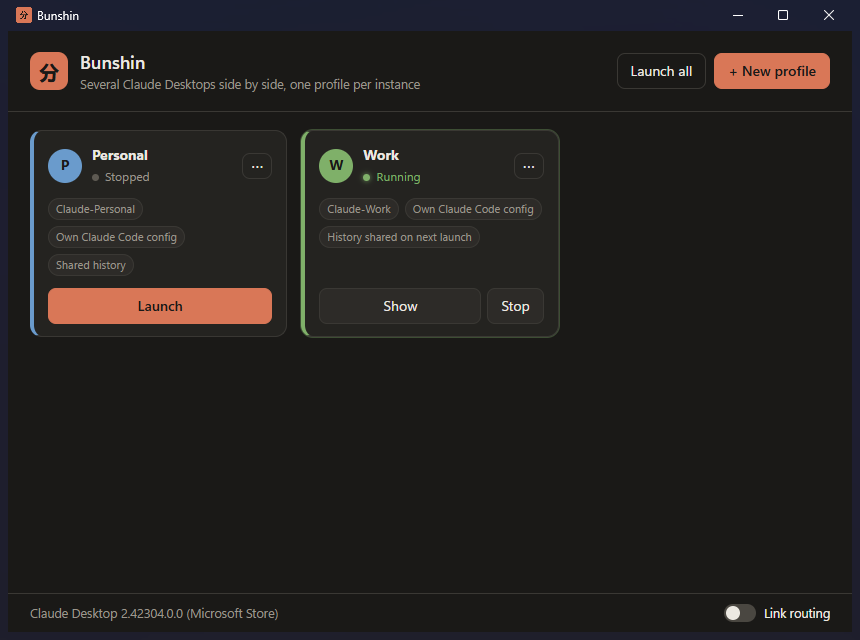

# Bunshin

**Run several Claude Desktop instances side by side on Windows, each with its own account.**

*Bunshin* (分身, "body double") is a small launcher. Each profile is a fully isolated Claude Desktop: its own login, settings and Claude Code setup, so you can keep a work account and a personal account open at the same time.



> Unofficial project, not affiliated with or endorsed by Anthropic. "Claude" is a trademark of Anthropic.

## Features

- **One window per profile.** Create as many profiles as you need and launch them together. Running and signed-in status is detected live, including instances opened outside Bunshin.
- **Sign in to a different account per profile.** Browser sign-in (Google, e-mail link…) is sent back to the profile that asked for it, not to whichever Claude happens to be open.
- **Shared Claude Code history.** Profiles can keep separate Claude Code settings while seeing the same sessions.
- **Ready to go.** Starts with a *Personal* and a *Work* profile; existing `%APPDATA%\Claude-Personal` / `Claude-Work` folders are reused.
- Portable `.exe`: no installer and no admin rights.

## Requirements

- Windows 10 or 11
- [Claude Desktop](https://claude.ai/download), Microsoft Store (MSIX) or classic installer

## Install

Download `Bunshin-x.y.z.exe` from the Releases page and run it. It's portable, so keep it somewhere stable: Windows starts it from that path.

Or build it yourself (see [Development](#development)).

## Usage

Bunshin starts with two profiles, **Personal** and **Work**.

1. A profile that isn't signed in shows **Sign in**. Click it, then sign in inside the window that opens (Google, e-mail link…). The browser's callback is delivered to that profile.
2. **Launch** opens a profile's Claude window, **Launch all** opens every profile, **Stop** closes one (including the Claude Code sessions running in it).
3. **+ New profile** adds more. *Also isolate the Claude Code config* gives the profile its own `CLAUDE_CONFIG_DIR` (`~/.claude-<name>`).
4. The **⋯** menu has edit, data folder, reorder and remove (the data stays on disk).

## How it works

### Isolated instances

Each profile runs `Claude.exe --user-data-dir=<folder>`. A different folder means a different Electron single-instance lock, so the instances run independently.

The Store build of Claude has a "user data move": once `%LOCALAPPDATA%\Claude-Data\<package>` exists, Claude ignores `--user-data-dir` and switches to that shared folder. Every profile would then share one login. Claude skips this for a profile whose MSIX copy (`%LOCALAPPDATA%\Packages\<package>\LocalCache\Roaming\<folder>`) holds a `.user-data-back.<package>` marker. Bunshin writes that marker before each launch (`pinToOwnFolder` in `src/claude.js`).

### Browser sign-in

Sign-in comes back through a `claude://` link. On the Store build, Windows always hands it to Claude's own package handler, which opens it in the default profile. Only the user can change that default, in Settings.

So when you click **Sign in**, the profile is "armed" for 5 minutes. During that time Bunshin watches for the `Claude.exe "claude://…"` process Windows starts, kills it and passes the link to the armed profile (`src/intercept.js`). If the default profile is open, Bunshin asks to close it first, otherwise it would receive the link before Bunshin can step in.

Every routed link is logged in `%APPDATA%\Bunshin\bunshin.log`, without the one-time codes.

The **Link routing** toggle is optional. It registers Bunshin as a `claude:` handler in Windows, which only matters if you then pick Bunshin in Settings → Default apps.

### Shared history

For a profile with its own `CLAUDE_CONFIG_DIR`, the session folders (`projects`, `file-history`, `todos`) become junctions to `~/.claude`. Logins and settings stay per profile, sessions are shared. This happens when a closed profile is launched. Existing content is merged first (the newest copy of each file wins), and the original folder is kept as `<folder>.before-bunshin-<date>`. You can turn it off per profile.

## Caveats

- Bunshin relies on undocumented Claude Desktop behavior (the user data move, the sign-in links). A Claude update can break it. If profiles start sharing a login after an update, that's the first place to look.
- Sign-in interception kills a Claude process on purpose. It only runs while a profile is armed.
- Windows only.

## Development

```bash
npm install
npm start      # run from source
npm test       # unit tests (node --test)
npm run dist   # build dist/Bunshin-<version>.exe
```

- npm 11 blocks install scripts by default. `package.json` allows the ones Electron needs (`allowScripts`).
- If `npm start` says Electron failed to install, extract the zip from `%LOCALAPPDATA%\electron\Cache` into `node_modules/electron/dist` and write `electron.exe` to `node_modules/electron/path.txt`.
- `BUNSHIN_USER_DATA=<folder>` runs Bunshin with a separate data folder (its own profile list and log), handy for trying things without touching your setup.
- When testing from a process started by Claude Desktop (e.g. Claude Code), you're inside Claude's MSIX container: `%APPDATA%` and `HKCU` are virtualized. Start Bunshin through `explorer.exe` to see the real system.

```
src/
  main.js       Electron main process: window, IPC, sign-in routing
  claude.js     finding Claude, launching / stopping instances, MSIX folders
  intercept.js  catches claude:// links while a profile is armed
  history.js    shared Claude Code history (junctions)
  profiles.js   profile list (profiles.json in Bunshin's data folder)
  renderer/     UI
test/           unit tests
```

## License

[MIT](LICENSE)
